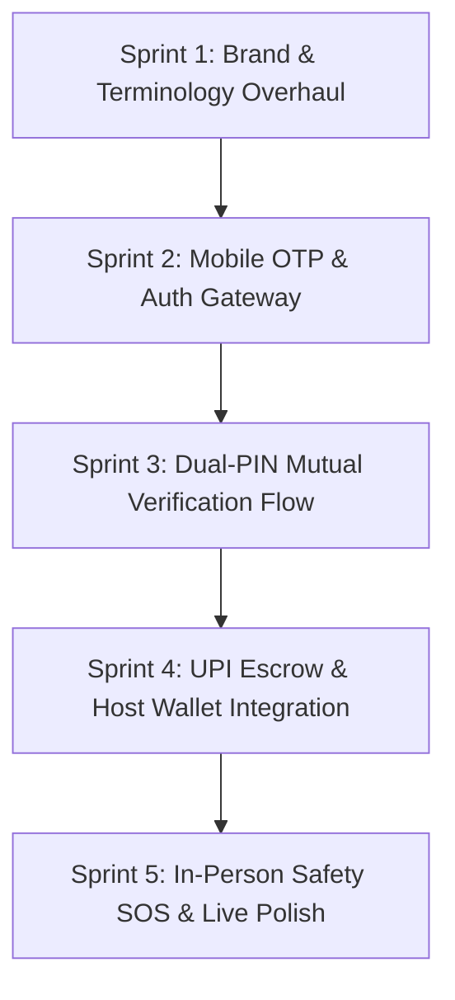

# Feature & Architecture Spec: Cue Mobile Client (Flutter)

**Document Status**: Completed & Shipped (Sprints 1-5 Verified)
**Target Milestone**: Cue Mobile v1.0.0 (iOS & Android)
**Test Suite**: 33 tests passing (`flutter test` 100% green, 0 analysis warnings)
**Related Specs**:

- [`docs/specs/dual-pin-session-verification.md`](./dual-pin-session-verification.md)
- [`docs/specs/bookings-workflow-and-calendar.md`](./bookings-workflow-and-calendar.md)
- [`docs/specs/user-identity-verification-kyc.md`](./user-identity-verification-kyc.md)
- [`DESIGN.md`](../../DESIGN.md)
- [`AGENTS.md`](../../AGENTS.md)

---

## 1. Executive Summary & Problem Statement

### 1.1 The "Why"

Cue is an experience companion marketplace connecting verified **Guests** (Seekers) with vetted **Hosts** (Companions) for platonic, curated social activities (museum tours, gallery walks, cafe conversations, dining, events).

While Cue's web platform operates in production on Kubernetes, experience companionship is inherently mobile, location-aware, and in-person. The mobile client is the primary runtime for:

1. **Real-time In-Person Safety & Verification**: Physical check-ins requiring instant cryptographic Mutual PIN exchange (Arrival PIN & Completion PIN) between Guest and Host phones.
2. **Instant Escrow & UPI Operations**: Push notifications on booking requests, fast UPI top-ups, and immediate companion earnings withdrawal.
3. **Location-Aware Discovery & Emergency Protocols**: Discreet safety SOS triggers during active outings, live geolocated companion discovery, and instant chat.

### 1.2 Status Quo & Deficiencies in Current Mobile Baseline

The mobile client located in `mobile/` was bootstrapped with Flutter/Riverpod/GoRouter and currently passes 13 core tests, but suffers from significant architectural drift:

1. **Design System Divergence**: Mobile still uses the deprecated terracotta (`#D86E51`) / sage (`#587363`) palette rather than the luxury brand standard codified in [`DESIGN.md`](../../DESIGN.md) (Warm Cashmere Ivory `#FAF7F2`, Rich Bordeaux Velvet `#881337`, Burnished Champagne Gold `#C5A059`, JetBrains Mono numerals).
2. **Terminology Fragmentation**: Mobile models and UI still utilize legacy `Seeker` and `Provider` terminology instead of the platform-standard **`Guest`** and **`Host`**.
3. **Missing Dual-PIN Safety Enforcement**: The mobile booking screen currently contains bypass buttons (`"Start Live Session"`, `"Complete Session"`) without enforcing the mandatory 6-digit mutual Arrival PIN and Completion PIN verification required by the domain and backend API.
4. **Outdated Auth Strategy**: Mobile relies on static email/password mock forms without phone/email OTP verification endpoints recently deployed on Kubernetes (`/api/v1/auth/login-otp`, `/verify-otp`).
5. **Localization Mismatch**: Seed datasets use New York/Brooklyn references and USD rates rather than metropolitan Indian hubs (Bengaluru, Mumbai, Delhi-NCR) and Indian Rupee (`₹`) escrow pricing.

---

## 2. Scope & Boundaries

### 2.1 In Scope (Phase 1 Execution)

- **Design System Alignment**: Complete theme overhaul to Cashmere Ivory, Bordeaux Velvet (`#881337`), Champagne Gold (`#C5A059`), with 44x44px minimum touch targets and tabular INR formatting.
- **Domain & Terminology Refactoring**: Refactor all models (`User`, `ProviderProfile` -> `HostProfile`, `Booking` -> `Outing`), state controllers, and UI copy to `Host` and `Guest`.
- **Dual-PIN Mutual Verification**: Full implementation of the Arrival PIN voucher/entry modal and Completion PIN voucher/entry modal with backend API synchronization.
- **Mobile-First OTP Authentication**: Seamless OTP login and email verification flow integrated with the backend Mailjet service.
- **Real-Time Outing Lifecycle & UPI Wallet**: Escrow status tracking, UPI top-ups, and Host earnings ledger in INR (`₹`).
- **Discreet Emergency SOS Trigger**: Emergency action sheet during active outings with simulated/actual local emergency dispatch coordinates.

### 2.2 Out of Scope (Deferred to v1.1+)

- Background continuous GPS breadcrumb tracking (Phase 1 uses point-in-time check-in geocoding).
- In-app WebRTC video calling (communications remain platonic text chat and in-person meetings).
- Biometric biometric hardware passkeys (Phase 1 uses secure storage JWT + PIN).

### 2.3 Strict Constraints & Invariants

- **Platonic Only**: Strictly platonic companionship framing. All adult or escort-adjacent terminology is strictly prohibited.
- **Escrow Invariant**: Funds are held in escrow on booking confirmation. Escrow release to Host wallet is strictly locked behind successful Seeker verification of the Host's 6-digit Completion PIN. Direct transition from Confirmed to Completed is forbidden.
- **Touch Target Accessibility**: Minimum 44x44px touch targets on all interactive buttons, chips, and controls across both iOS and Android.

---

## 3. Architecture & System Design

### 3.1 Technology Stack

- **Framework**: Flutter 3.35.6 (Dart 3.9.2)
- **State Management**: `flutter_riverpod: ^2.6.1` (NotifierProvider pattern)
- **Navigation & Deep Linking**: `go_router: ^14.6.2` (Declarative, auth-guarded routing)
- **Networking & API**: `dio: ^5.7.0` with JWT interceptors, exponential backoff, and offline mock fallback
- **Local Secure Storage**: `shared_preferences: ^2.3.5` (plus secure keychain token caching)
- **Formatting**: `intl: ^0.20.3` (Indian Rupee `₹` currency formats, localized dates)

### 3.2 Directory Structure

```
mobile/lib/
├── app.dart                                # GoRouter routes & MaterialApp configuration
├── main.dart                               # App bootstrap with ProviderScope
├── core/
│   ├── api_client.dart                     # Dio HTTP client, JWT interceptor, refresh logic
│   ├── constants.dart                      # Platform fee rate (10%), API base URL, storage keys
│   ├── theme.dart                          # Bordeaux & Cashmere design tokens, typography, M3 theme
│   └── utils/
│       ├── currency_formatter.dart         # JetBrains Mono INR (₹) formatting helper
│       └── haptic_feedback.dart            # Native haptics for PIN entries and actions
├── data/
│   ├── mock_data.dart                      # Curated Indian metro seeds (Bengaluru, Mumbai, Delhi)
│   └── repositories/
│       ├── auth_repository.dart            # OTP request, verify, and session persistence
│       ├── host_repository.dart            # Host discovery, filters, reviews, availability
│       ├── outing_repository.dart          # Outing booking, Dual-PIN checkin & completion
│       ├── wallet_repository.dart          # INR wallet balance, UPI transactions, payout requests
│       └── chat_repository.dart            # Real-time messages and thread history
├── features/
│   ├── auth/                               # Phone/Email OTP sign-in and registration
│   │   ├── auth_controller.dart
│   │   ├── login_screen.dart
│   │   └── otp_verification_screen.dart
│   ├── discovery/                          # Host exploration, archetype filter, host profile
│   │   ├── discovery_controller.dart
│   │   ├── discovery_screen.dart
│   │   └── host_detail_screen.dart
│   ├── outing/                             # Booking creation & Dual-PIN lifecycle
│   │   ├── outing_controller.dart
│   │   ├── outing_booking_screen.dart
│   │   ├── outing_detail_screen.dart
│   │   ├── outings_list_screen.dart
│   │   └── widgets/
│   │       ├── arrival_pin_voucher_card.dart
│   │       ├── completion_pin_voucher_card.dart
│   │       ├── pin_input_modal.dart
│   │       └── emergency_sos_bottom_sheet.dart
│   ├── wallet/                             # INR balance, UPI top-up, escrow ledger
│   │   ├── wallet_controller.dart
│   │   └── wallet_screen.dart
│   ├── chat/                               # Platonic conversation threads
│   │   ├── chat_controller.dart
│   │   ├── chat_screen.dart
│   │   └── messages_screen.dart
│   ├── profile/                            # Trust score, KYC badge, Host/Guest mode switcher
│   │   └── profile_screen.dart
│   ├── navigation/                         # 5-tab luxury bottom navigation shell
│   │   └── main_navigation_shell.dart
│   └── widgets/                            # Reusable luxury components
│       ├── champagne_trust_badge.dart
│       ├── verified_badge.dart
│       └── luxury_card.dart
└── models/
    ├── host_profile.dart                   # Host domain model & availability slots
    ├── outing.dart                         # Outing aggregate with ArrivalPin & CompletionPin
    ├── user.dart                           # Guest & Host unified user identity
    ├── wallet.dart                         # Wallet ledger, transaction, and escrow models
    └── chat_message.dart                   # Chat exchange entity
```

---

## 4. Detailed Component Specifications

### 4.1 Design System & Theme Engine (`mobile/lib/core/theme.dart`)

```dart
class AppColors {
  // Brand Palette (from DESIGN.md)
  static const Color background = Color(0xFFFAF7F2);      // Warm Cashmere Ivory
  static const Color surface = Color(0xFFFFFFFF);         // Pure White
  static const Color surfaceMuted = Color(0xFFF4EFEA);    // Soft Linen Tint
  static const Color primary = Color(0xFF881337);         // Rich Bordeaux Velvet
  static const Color primaryHover = Color(0xFF9F1239);    // Deep Wine Accent
  static const Color primaryLight = Color(0xFFFCE7F3);    // Rose Wash Tint
  static const Color gold = Color(0xFFC5A059);            // Burnished Champagne Gold
  static const Color goldLight = Color(0xFFFBF4E6);        // Champagne Glow Tint

  // Text Hierarchy
  static const Color textPrimary = Color(0xFF1C1917);     // Charcoal Espresso
  static const Color textSecondary = Color(0xFF78716C);   // Warm Stone
  static const Color textMuted = Color(0xFFA8A29E);       // Neutral Muted

  // System & Lifecycle Tokens
  static const Color border = Color(0xFFE7E2D9);
  static const Color statusPending = Color(0xFFD97706);   // Amber
  static const Color statusConfirmed = Color(0xFF881337); // Bordeaux Active
  static const Color statusInProgress = Color(0xFFC5A059);// Gold In-Flight
  static const Color statusCompleted = Color(0xFF047857); // Forest Emerald
  static const Color statusCancelled = Color(0xFFDC2626); // Crimson
}
```

### 4.2 Dual-PIN Mutual Verification Protocol

#### State Machine Flow

```
[Requested / Pending Payment]
          │ (Guest Pays Escrow via UPI / Wallet)
          ▼
     [Confirmed]
          │
          ├─► Guest Screen: Displays 6-digit Arrival PIN ("Present to Host upon meeting")
          ├─► Host Screen: Displays [Verify Arrival PIN] button
          │
          │ (Host inputs Guest's Arrival PIN -> PATCH /api/v1/bookings/{id}/checkin)
          ▼
    [In Progress]
          │
          ├─► Host Screen: Displays 6-digit Completion PIN ("Share with Guest at outing conclusion")
          ├─► Guest Screen: Displays [Verify Completion PIN] button
          │
          │ (Guest inputs Host's Completion PIN -> PATCH /api/v1/bookings/{id}/complete)
          ▼
     [Completed] ──► Escrow auto-released to Host's wallet balance
```

#### Acceptance Criteria (Gherkin)

```gherkin
Scenario: Host verifies Guest Arrival PIN at meetup point
  Given the outing status is "Confirmed"
  And the Guest is presented with Arrival PIN "482910"
  When the Host enters "482910" into the PinInputModal
  Then the app sends a PATCH request to "/api/v1/bookings/{id}/checkin" with pin "482910"
  And the outing status updates to "In Progress"
  And the UI displays the active outing safety banner with SOS trigger

Scenario: Guest verifies Host Completion PIN to conclude outing & release escrow
  Given the outing status is "In Progress"
  And the Host is presented with Completion PIN "739184"
  When the Guest enters "739184" into the PinInputModal
  Then the app sends a PATCH request to "/api/v1/bookings/{id}/complete" with completionPin "739184"
  And the outing status updates to "Completed"
  And the escrow amount is credited to the Host wallet balance
  And the Guest is prompted to rate and review the Host
```

### 4.3 Mobile OTP Authentication & Mailjet Integration

1. **Step 1: Request OTP (`/api/v1/auth/login-otp` or `/register-otp`)**
   - User inputs email address or mobile number.
   - Backend persists 6-digit OTP with 5-minute expiry in `auth.verification_otps` table and triggers Mailjet transactional email / SMS gateway.
2. **Step 2: Enter 6-Digit OTP**
   - 6-box segmented numeric field with auto-advance and SMS auto-fill.
   - Resend timer cooldown (60 seconds).
3. **Step 3: Verification & Token Storage (`/api/v1/auth/verify-otp`)**
   - On success, receives JWT `accessToken` and user profile.
   - Saves to `shared_preferences` and sets Dio client header `Authorization: Bearer <token>`.

### 4.4 In-Person Safety & Emergency SOS Feature

During `In Progress` outings:

- A persistent, high-visibility amber/gold safety shield banner is pinned to the top of the app.
- Tapping **SOS Safety Beacon** displays an emergency modal with 3 instant options:
  1. **Discreet Check-In**: Sends SMS alert with live GPS coordinates to pre-configured trusted contact.
  2. **Call 112 (National Emergency)**: Instant one-tap dialer launch to India emergency dispatch.
  3. **End Outing Early & Request Support**: Flags outing order as disputed with immediate safety team notification.

---

## 5. Implementation Roadmap & Execution Sprints



| Sprint | Objective | Deliverables | Verification Test |
| ------------------ | ------------------------------------ | ---------------------------------------------------------------------------------------------------------------------------------------------------------------------------------------------------------------------- | ------------------------------------------------------------------- |
| **Sprint 1** | Brand & Terminology Overhaul | - Update `AppColors` to Bordeaux (`#881337`), Ivory (`#FAF7F2`), Gold (`#C5A059`).- Refactor models & controllers to `Host` and `Guest`.- Update mock dataset to Indian cities (Bengaluru, Mumbai, Delhi). | `flutter test` passes with updated models and color checks. |
| **Sprint 2** | Mobile OTP & Auth Gateway | - Build `OtpVerificationScreen` with 6-box input.- Integrate `AuthRepository` with backend OTP endpoints.- Support one-click demo sign-in for Host and Guest. | Widget test verifies OTP entry, countdown timer, and token storage. |
| **Sprint 3** | Dual-PIN Mutual Verification Flow | - Implement `ArrivalPinVoucherCard` and `CompletionPinVoucherCard`.- Build `PinInputModal` with vibration feedback.- Wire `OutingRepository.checkIn()` & `complete()`. | Unit and UI tests enforce strict sequencing and PIN matching. |
| **Sprint 4** | UPI Escrow & Host Wallet Integration | - Connect `WalletScreen` with live `/payments/wallet` endpoints.- Implement INR escrow holds and instant payout requests.- Add Razorpay/UPI intent launcher stub. | Test verifies escrow balance debit and credit on completion. |
| **Sprint 5** | In-Person Safety SOS & Live Polish | - Add SOS action sheet to active outing screen.- Ensure 44x44px minimum touch targets throughout.- Validate seamless offline fallback mode. | Full end-to-end simulation passes without errors. |

---

## 6. Risk Analysis & Mitigations

| Risk                                              | Likelihood | Impact   | Mitigation Strategy                                                                                                                                                                                             |
| ------------------------------------------------- | ---------- | -------- | --------------------------------------------------------------------------------------------------------------------------------------------------------------------------------------------------------------- |
| **Offline Connectivity during Meetup**      | Medium     | High     | Cache PINs locally on client once outing enters `Confirmed`. If network drops at cafe/venue, companion app displays offline verification QR code or records timestamped signature for sync upon reconnection. |
| **Accidental PIN Leakage**                  | Low        | Critical | Ensure API contract never returns `ArrivalPin` to Host or `CompletionPin` to Guest before the respective stage. Vouchers have blur privacy overlays.                                                        |
| **Sub-44px Touch Targets on Small Screens** | Medium     | Medium   | Wrap all touchable icons and buttons in `ConstrainedBox(constraints: BoxConstraints(minWidth: 44, minHeight: 44))`.                                                                                           |
