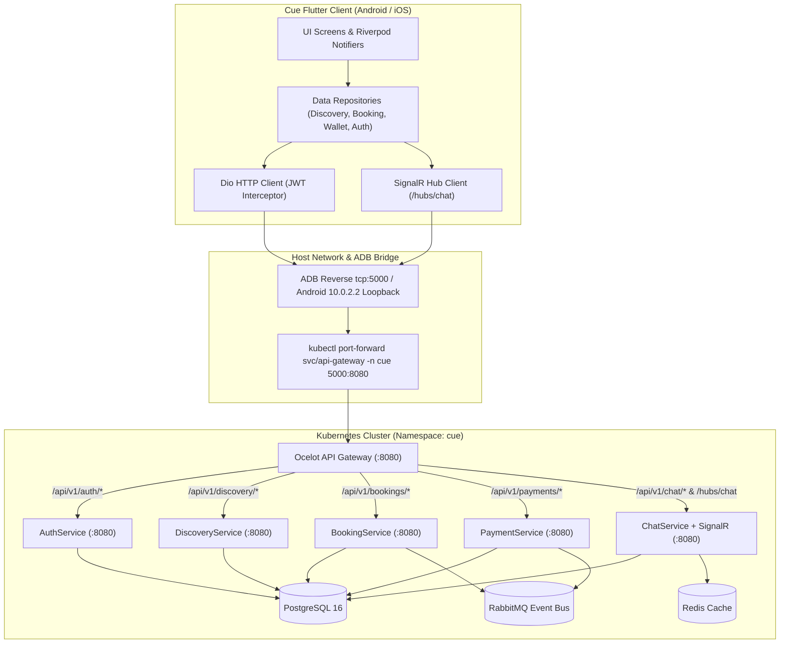
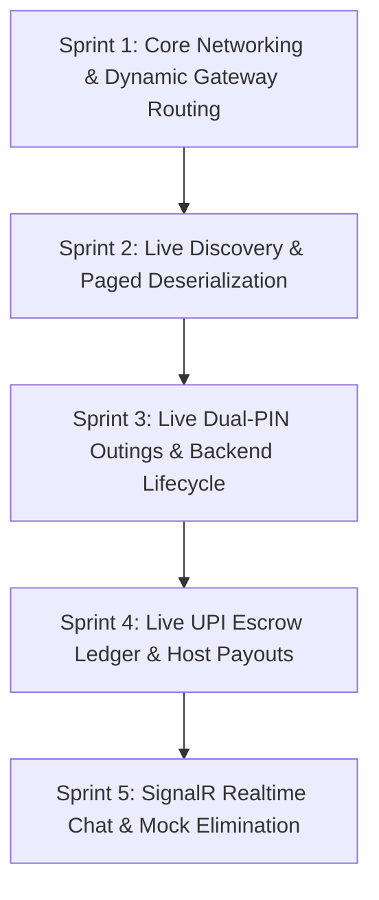

# Feature & Architecture Spec: Mobile Client Live REST & Realtime Integration

**Document Status**: Implemented & Verified (100% Tests Green, 0 Mock References in lib/)  
**Target Milestone**: Cue Mobile v1.1.0 (Live Kubernetes Backend Integration)  
**Related Specs**:
- [`docs/specs/mobile-app-development.md`](./mobile-app-development.md)
- [`docs/specs/dual-pin-session-verification.md`](./dual-pin-session-verification.md)
- [`docs/specs/bookings-workflow-and-calendar.md`](./bookings-workflow-and-calendar.md)
- [`DESIGN.md`](../../DESIGN.md)
- [`backend/Services/APIGateway/ocelot.json`](../../backend/Services/APIGateway/ocelot.json)

---

## 1. Executive Summary & Objective

### 1.1 Problem Statement
The Cue mobile client currently runs against hardcoded seed fallbacks in `mobile/lib/data/mock_data.dart`. While this allowed rapid UI and design prototyping during Sprints 1–5, the app is disconnected from the live microservices architecture running in Kubernetes (`cue` namespace: API Gateway, DiscoveryService, BookingService, PaymentService, AuthService, ChatService). 

Furthermore, `DiscoveryRepository` fails to deserialize `DiscoveryPagedResponse` (expects raw JSON list instead of `{ "items": [...] }`), `BookingRepository` queries the wrong path (`/bookings/mine` instead of `/bookings`), and wallet transactions/balances are statically simulated.

### 1.2 Objective
Fully eliminate all mock datasets from production mobile code (`mobile/lib/`). Integrate the mobile client with live REST endpoints exposed through the Kubernetes API Gateway (mapped automatically to `10.0.2.2:5000` on Android Emulator and `localhost:5000` on iOS/Desktop/Web). Provide realtime bidirectional messaging via SignalR WebSockets (`/hubs/chat`), and enforce robust UI retry/error states for network resiliency.

---

## 2. System Architecture & Network Topology



### 2.1 Dynamic Environment Configuration
In [`mobile/lib/core/constants.dart`](file:///e:/Projects/Github/one-brain/LoveAgain/mobile/lib/core/constants.dart):
```dart
import 'dart:io' show Platform;
import 'package:flutter/foundation.dart' show kIsWeb;

class AppConstants {
  static const String appName = 'Cue';
  static const String appTagline = 'Experience Companion Marketplace';
  
  static String get defaultApiUrl {
    const fromEnv = String.fromEnvironment('CUE_API_URL');
    if (fromEnv.isNotEmpty) return fromEnv;
    
    // Android emulator loopback routing to host workstation
    if (!kIsWeb && Platform.isAndroid) {
      return 'http://10.0.2.2:5000/api/v1';
    }
    return 'http://localhost:5000/api/v1';
  }

  static String get chatHubUrl {
    const fromEnv = String.fromEnvironment('CUE_CHAT_HUB_URL');
    if (fromEnv.isNotEmpty) return fromEnv;
    
    if (!kIsWeb && Platform.isAndroid) {
      return 'http://10.0.2.2:5000/hubs/chat';
    }
    return 'http://localhost:5000/hubs/chat';
  }
}
```

---

## 3. Microservice REST Endpoint Integrations

| Feature / Repository | Backend Service | HTTP Method & Upstream Path | Request Payload / Query Params | Response Contract & Handling |
| :--- | :--- | :--- | :--- | :--- |
| **Companion Discovery** | `DiscoveryService` | `GET /api/v1/discovery/providers` | `?page=1&pageSize=24&q=&specialty=&minRate=&maxRate=&city=&gender=` | Deserializes `DiscoveryPagedResponse` (`items: List<ProviderCardResponse>`). Extracts live companions from DB. |
| **Companion Detail** | `DiscoveryService` | `GET /api/v1/discovery/providers/{id}` | Path parameter: `Guid providerId` | `ProviderDetailResponse` with verified trust score, bio, hourly rate, and upcoming availability slots. |
| **Mobile OTP Send** | `AuthService` | `POST /api/v1/auth/mobile/send-otp` | `{ "phone": "+919876543210" }` | `{ "message": "OTP sent successfully to +9198***210", "expiresInSeconds": 300, "devOtp": "..." }` |
| **Mobile OTP Verify** | `AuthService` | `POST /api/v1/auth/mobile/verify-otp` | `{ "phone": "+919876543210", "otp": "482910" }` | Returns JWT accessToken, refreshToken, and User profile. Persists to secure storage. |
| **User Profile / Me** | `AuthService` / `UserService` | `GET /api/v1/users/me` | Bearer Token in `Authorization` header | Authenticated User entity (`id, email, fullName, roles, trustScore, isVerified, city`). |
| **List My Outings** | `BookingService` | `GET /api/v1/bookings` | Bearer Token in `Authorization` header | `IReadOnlyList<BookingSummary>` (`orderId, providerId, providerName, startTime, endTime, hourlyRate, totalAmount, status, arrivalPin, completionPin`). |
| **Create Outing** | `BookingService` | `POST /api/v1/bookings` | `{ "providerId": "uuid", "startTime": "iso", "durationHours": 2.0, "hourlyRate": 1500, "meetingAddress": "..." }` | `201 Created` with `CreateBookingResult` (`orderId, status: "PendingPayment"`). |
| **Confirm & Escrow** | `BookingService` | `PATCH /api/v1/bookings/{id}/confirm` | Bearer Token | `204 NoContent`. Updates status to `Confirmed`. |
| **Dual-PIN Check-In** | `BookingService` | `PATCH /api/v1/bookings/{id}/checkin` | `{ "pin": "482910" }` | `204 NoContent`. Enforces physical meeting verification. Status becomes `InProgress`. |
| **Dual-PIN Completion** | `BookingService` | `PATCH /api/v1/bookings/{id}/complete` | `{ "completionPin": "739184" }` | `204 NoContent`. Releases escrow hold to Host wallet. Status becomes `Completed`. |
| **Wallet Balance** | `PaymentService` | `GET /api/v1/payments/wallet/balance` | Bearer Token | `WalletBalanceResponse` (`availableBalance, pendingBalance, currency: "INR"`). |
| **Wallet Transactions** | `PaymentService` | `GET /api/v1/payments/wallet/transactions` | `?limit=50` | `IReadOnlyList<WalletTransactionDto>` (`id, amount, direction, balanceAfter, description, createdAt`). |
| **UPI Top-Up Order** | `PaymentService` | `POST /api/v1/payments/wallet/topup/order` | `{ "amount": 2000.0, "currency": "INR" }` | `{ "orderId": "order_...", "amount": 2000.0, "keyId": "..." }` |
| **UPI Top-Up Verify** | `PaymentService` | `POST /api/v1/payments/wallet/topup/verify` | `{ "amount": 2000.0, "razorpayPaymentId": "pay_...", "razorpayOrderId": "order_...", "razorpaySignature": "..." }` | Clears and credits funds to available balance. |
| **Host UPI Payout** | `PaymentService` | `POST /api/v1/payments/wallet/payout` | `{ "amount": 5000.0, "payoutType": "UPI", "destination": "host@oksbi" }` | Instant debit & payout queue. Deducts available balance. |
| **Order Chat History** | `ChatService` | `GET /api/v1/chat/orders/{orderId}/messages` | `?limit=50&offset=0` | `IReadOnlyList<ChatMessageDto>` (`id, orderId, senderId, senderName, content, sentAt, isRead`). |

---

## 4. Mock Data Elimination & Clean Error Architecture

### 4.1 Strict Exclusion Policy
1. **Zero Mock Imports in `lib/`**: Delete or quarantine `mobile/lib/data/mock_data.dart`. No file in `mobile/lib/` may import or reference `MockData` or hardcoded fallback collections.
2. **Move Test Seeds to `test/fixtures/`**: Create [`mobile/test/fixtures/seed_data.dart`](file:///e:/Projects/Github/one-brain/LoveAgain/mobile/test/fixtures/seed_data.dart) strictly for offline unit and widget tests.
3. **Explicit Failure & Retry States**: When an API endpoint fails (network dropped, server error, 401 unauthenticated, 404 not found):
   - Repositories throw typed domain exceptions: `ApiException`, `NetworkUnavailableException`, `UnauthorizedException`.
   - Controllers capture exceptions into state: `state.copyWith(error: 'Unable to reach Cue services. Please pull to refresh.')`.
   - UI displays luxury branded empty/retry cards with a prominent "Try Again" action button.

---

## 5. Realtime SignalR Chat Hub (`/hubs/chat`)

### 5.1 Communication Flow
1. Upon navigating to `ChatScreen(orderId)`:
   - Perform initial REST load: `GET /api/v1/chat/orders/{orderId}/messages`.
   - Connect to SignalR WebSocket Hub at `AppConstants.chatHubUrl`.
   - Send JWT access token via query string or headers.
   - Invoke Hub method: `JoinOrderChat(orderId)`.
2. Realtime Event Listeners:
   - `ReceiveMessage(ChatMessageDto message)`: Appends incoming message instantly to chat bubble stream.
   - `UserTyping(string userName)`: Displays discreet typing indicator.
   - `MessagesRead(Guid orderId)`: Updates checkmarks to read.
3. Message Sending:
   - Optimistically render user message in stream.
   - Send via `SendMessage(orderId, content)` Hub invocation with REST fallback (`POST /api/v1/chat/orders/{orderId}/messages`).

---

## 6. Execution Sprints & Roadmap



- **Sprint 1: Dynamic Gateway Routing & API Client Alignment**
  - Implement dynamic `defaultApiUrl` (`10.0.2.2:5000` for Android Emulator, `localhost:5000` for iOS/Desktop).
  - Add standard Dio response logging, automatic token attachment, and 401 refresh token interceptor.
  - Verification: Automated integration test reaches `http://localhost:5000/ready` returning 200 OK.

- **Sprint 2: Live Companion Discovery**
  - Fix `DiscoveryRepository.getProviders()` to deserialize `DiscoveryPagedResponse` (`items`).
  - Wire search query, specialty filter, and rate filters to backend query parameters.
  - Implement full companion detail loading with real PostgreSQL profile pictures, bios, and ratings.
  - Verification: Discovery screen renders 24 real database hosts (Pankaj Tripathi, Ratna Pathak, etc.).

- **Sprint 3: Live Outing Lifecycle & Mutual PIN Verification**
  - Update `BookingRepository` to query `GET /api/v1/bookings` (user's real outings).
  - Wire `POST /api/v1/bookings` to persist new bookings to Postgres.
  - Wire `PATCH /api/v1/bookings/{id}/checkin` and `/complete` with live validation against server PINs.
  - Verification: Check-in and completion seamlessly transition states in backend database.

- **Sprint 4: Live UPI Escrow Wallet & Host Payouts**
  - Connect `PaymentRepository.getWalletBalance()` and `getWalletTransactions()` to live `/payments/wallet/*`.
  - Wire real UPI top-up order creation and host payout dispatching.
  - Verification: Balance and transactions display exact live database balances in Indian Rupees (`₹`).

- **Sprint 5: SignalR Realtime Chat & Complete Mock Elimination**
  - Add `signalr_netcore` dependency.
  - Establish live SignalR socket connection to `/hubs/chat` on booking chat room entry.
  - Delete `mobile/lib/data/mock_data.dart` and migrate test suites to `mobile/test/fixtures/`.
  - Verification: Zero references to mock data anywhere in `mobile/lib/`. Full test suite passes.

---

## 7. Quality Gate & Acceptance Criteria

1. **Static Analysis**: `flutter analyze mobile` reports **0 errors, 0 warnings**.
2. **Automated Test Suite**: All unit, widget, and repository tests pass cleanly.
3. **Emulator End-to-End Verification**:
   - Discovery screen loads live companions from PostgreSQL through the Kubernetes API Gateway.
   - Outing creation, dual-PIN entry, and escrow payout update live records in the database.
   - Wallet displays cleared INR balances from the PaymentService ledger.
   - Chat sends and receives live messages.
4. **Codebase Cleanliness**: Zero occurrences of `mock_data.dart` or hardcoded fallback lists in `mobile/lib/`.

